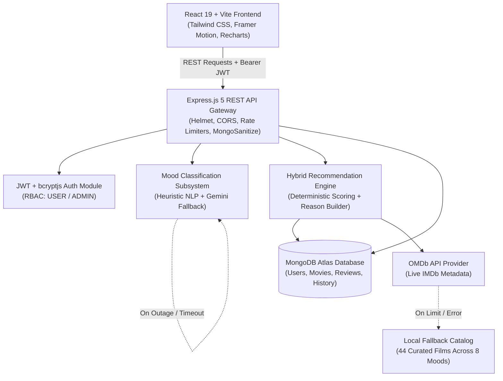

# Moodie — AI Mood-Based Movie Recommendation System 🎬🧠

> **Master of Computer Applications (MCA) Final Year Project**  
> A full-stack, emotionally intelligent movie discovery platform that analyzes users' emotional states—via interactive mood tags or natural-language sentiment analysis—and provides explainable, ranked movie recommendations backed by OMDb metadata and local fallbacks.

---

## 📌 Problem Statement

Traditional movie streaming and recommendation platforms rely predominantly on generic popularity charts or collaborative filtering based on historical views. However, human viewing desires are strongly dictated by **current emotional state**: a viewer who is emotionally exhausted after a stressful workday seeks warm, comforting comedy; someone feeling introspective seeks thought-provoking drama; someone seeking adrenaline wants high-octane action. 

Traditional platforms force users to scroll through hundreds of unrelated titles, causing **decision fatigue**. **Moodie** solves this by providing:
1. Immediate emotional alignment (8 standard mood categories or conversational free-text analysis).
2. Deterministic hybrid scoring combining mood-to-genre mapping, IMDb rating normalization, popularity log scaling, and user genre preferences.
3. Transparent, truthful recommendation reasons explaining *why* each movie was suggested.
4. Resilient multi-tier architecture ensuring zero service interruptions even during external network outages.

---

## ✨ Key Features

### For Users
- **Dual Mood Input Modes**: 
  - *Mode 1 (Predefined Tags)*: 8 emotional categories (`Happy`, `Sad`, `Romantic`, `Angry`, `Excited`, `Relaxed`, `Fearful`, `Motivated`).
  - *Mode 2 (Conversational NLP)*: Free-text emotion description with negation handling, Hinglish idiom recognition, and contrast detection.
- **Explainable Hybrid Recommendations**: Ranked by dynamic match scores (0–100%) with human-readable rationale.
- **Comprehensive Movie Catalog**: Real-time search with multi-parameter filtering (genre, release year, minimum rating, language, and sorting).
- **Personalized Library**: One-click Watchlist and Favorites curation with optimistic client synchronization.
- **Audience Reviews & Sentiment Analysis**: 1–5 star ratings, text comments with automated sentiment detection (`positive`, `neutral`, `negative`), and XSS sanitization.
- **Mood History Timeline**: Chronological log of past mood submissions and quick recommendation re-generation.
- **User Profile & Customization**: Favorite genre preferences and Danger Zone account management.

### For Administrators
- **Telemetry & Visual Analytics**: Recharts dashboard displaying KPI metrics, user growth, mood distribution, review activity, and 7d/30d/90d time-series trends.
- **User Governance**: Account directory with search, role modification (`USER` vs `ADMIN`), and account status toggles (`active` vs `blocked`).
- **Review Moderation**: Full audit log of reviews with sentiment filters, visibility toggles (`visible` vs `hidden`), and deletion privileges.
- **Movie Catalog Management**: Modal-driven movie record creation, metadata editing, and cascade deletion.

---

## 🏗️ System Architecture



---

## 📸 Screenshots

*(Visual documentation of the application interface)*

| Landing & Emotional Hero | Mood Classification & NLP |
|:---:|:---:|
|  *Cinematic Hero Banner with Ambient Lighting* |  *8 Predefined Mood Tags & Free-Text Analyzer* |

| Ranked Hybrid Recommendations | Admin Visual Analytics |
|:---:|:---:|
|  *Ranked Recommendations with Match Scores* |  *Live KPI Metrics and Recharts Visualizations* |

---

## 🛠️ Technology Stack

| Layer | Technologies |
|---|---|
| **Frontend** | React 19, Vite 8, React Router v7, Tailwind CSS v4, Framer Motion, Lucide React, Recharts, React Hook Form, React Hot Toast, Axios |
| **Backend** | Node.js (CommonJS), Express.js v5, Mongoose v9, Helmet, CORS, Express-Rate-Limit, Express-Validator, Morgan, bcryptjs, jsonwebtoken |
| **Database** | MongoDB Atlas (Mongoose ODM with unique compound indexes and cascade hooks) |
| **External APIs** | OMDb API (Live Movie Metadata), Google Gemini API (NLP Analysis), Curated Local Fallback Dataset |
| **Code Quality & Testing** | Oxlint (strict linting), Node.js Native Test Runner (`node --test`), Custom Import & Security Verifiers |

---

## 📂 Repository Structure

```
mood-movie-app/
├── backend/
│   ├── src/
│   │   ├── ai/               # Local heuristic NLP classifier & Gemini external client
│   │   ├── config/           # Database connection configuration
│   │   ├── constants/        # Mood definitions and genre mappings
│   │   ├── controllers/      # Express route controllers
│   │   ├── data/             # 44 curated offline movies & IMDb candidate IDs
│   │   ├── middleware/       # JWT auth, RBAC, mongoSanitize, error handler
│   │   ├── models/           # Mongoose schemas (User, Movie, Review, MoodHistory)
│   │   ├── recommendation/   # Pure-function hybrid scorer & reason builder
│   │   ├── routes/           # REST API endpoint definitions
│   │   ├── scripts/          # Database index inspection script
│   │   ├── seed/             # Idempotent database seeder with demo accounts
│   │   ├── services/         # Movie data providers (OMDb, TMDb, Local)
│   │   ├── app.js            # Express application setup
│   │   └── server.js         # Server entry point & startup checks
│   ├── .env.example          # Backend environment variable template
│   └── package.json
├── frontend/
│   ├── scripts/              # React import integrity checker
│   ├── src/
│   │   ├── components/       # Common, movie, mood, navbar, and review UI components
│   │   ├── constants/        # Supported mood definitions and color themes
│   │   ├── context/          # AuthContext and LibraryContext providers
│   │   ├── layouts/          # Main consumer and admin layouts
│   │   ├── pages/            # Lazy-loaded page views
│   │   ├── routes/           # AppRoutes, ProtectedRoute, AdminRoute
│   │   ├── services/         # Axios API clients
│   │   └── utils/            # Helper utilities and movie mappers
│   ├── .env.example          # Frontend environment variable template
│   ├── vite.config.js        # Vite configuration with vendor manualChunks
│   └── package.json
├── docs/
│   ├── API_DOCS.md           # Complete REST API reference
│   ├── SRS_CHECKLIST.md      # Requirement verification status tracking
│   ├── SRS_AUDIT.md          # Formal SRS compliance audit report
│   ├── TESTING.md            # Testing manual & automated verification checklist
│   ├── DEPLOYMENT.md         # Production deployment guide (Atlas, Render, Vercel)
│   ├── VIVA_NOTES.md         # Academic viva explanation, architecture, Q&A
│   └── postman_collection.json # Exported Postman API test collection
├── .gitignore
└── README.md
```

---

## ⚙️ Installation & Setup

### Prerequisites
- Node.js (v18 or higher recommended)
- MongoDB Atlas cluster or local MongoDB instance

### 1. Clone the Repository
```bash
git clone https://github.com/bbs12abhaykumarkanaujiya0349-dot/mood-movie-app.git
cd mood-movie-app
```

### 2. Configure Backend Environment
Create `backend/.env` based on `backend/.env.example`:
```env
PORT=5000
NODE_ENV=development
MONGO_URI=your_mongodb_connection_string
JWT_SECRET=your_super_secret_jwt_key_at_least_32_characters_long
JWT_EXPIRES_IN=7d
CLIENT_URL=http://localhost:5173
OMDB_API_KEY=your_omdb_api_key
AI_API_KEY=your_gemini_api_key
AI_MODEL=gemini-3.8-flash
```

### 3. Configure Frontend Environment
Create `frontend/.env` based on `frontend/.env.example`:
```env
VITE_API_URL=http://localhost:5000/api
```

### 4. Install Dependencies & Seed Database
```bash
# Install backend dependencies
cd backend
npm install

# Seed demo users and initial movies (idempotent, safe to run multiple times)
npm run seed

# Install frontend dependencies
cd ../frontend
npm install
```

---

## 🚀 Running Locally

Open two terminal windows:

```bash
# Terminal 1: Start Backend Server (runs on http://localhost:5000)
cd backend
npm run dev

# Terminal 2: Start Frontend Development Server (runs on http://localhost:5173)
cd frontend
npm run dev
```

Visit `http://localhost:5173` in your browser.

---

## 🧪 Testing & Verification

Execute all test suites from the project root:

```bash
# 1. Run Backend Unit Tests (55 tests across 9 suites)
cd backend
npm test

# 2. Run Security Hardening Tests (NoSQL injection, rate limiting, blocked token)
npm run test:security

# 3. Verify Database Performance Indexes
npm run check:indexes

# 4. Run Frontend Missing Import Check and Production Build
cd ../frontend
npm run check

# 5. Run Strict Linting (Zero undef and valid hooks)
npm run lint:strict
```

For detailed manual User Acceptance Testing procedures, consult [`docs/TESTING.md`](docs/TESTING.md).

---

## 👥 Demo Accounts

The database seed script automatically creates standard testing accounts:

| Role | Email | Password | Access Privileges |
|---|---|---|---|
| **Standard User** | `user@moodie.demo` | `User@12345` | Mood Selection, Recommendations, Watchlist, Reviews, History, Profile |
| **Administrator** | `admin@moodie.demo` | `Admin@12345` | Full User Governance, Review Moderation, Movie Catalog CRUD, Analytics |

---

## 📖 API Documentation & Postman

- Comprehensive endpoint documentation: [`docs/API_DOCS.md`](docs/API_DOCS.md)
- Exported Postman Collection ready for import: [`docs/postman_collection.json`](docs/postman_collection.json)

---

## 🚀 Production Deployment

A step-by-step beginner guide covering MongoDB Atlas network whitelisting, Render web service configuration, Vercel single-page application rewrites, and post-deployment verification is documented in [`docs/DEPLOYMENT.md`](docs/DEPLOYMENT.md).

---

## ⚠️ Honest Limitations

1. **Rule-Based Recommendation Engine**: Recommendations are computed using a deterministic weighted multi-factor scoring formula. The system does not utilize machine learning embeddings or deep learning neural networks.
2. **OMDb Daily Rate Limit**: Free tier OMDb keys allow 1,000 queries per 24 hours. The application automatically falls back to the local movie dataset when quotas are exceeded.
3. **Local Mode Poster Placeholders**: Offline catalog movies utilize dynamic gradient cards with title and metadata rather than CDN-hosted image posters.
4. **Email Verification**: User accounts are active immediately without email confirmation links.
5. **Client-Side Stateless Logout**: JWT tokens are discarded in the browser without server-side Redis blacklisting.

---

## 🔮 Future Scope

- Integration with Spotify / Apple Music API to generate mood-matched movie soundtracks.
- Collaborative filtering using user-item interaction matrices once user volume surpasses 10,000+ ratings.
- Real-time cinema streaming availability indicators (JustWatch API).
- Native mobile application using React Native.
